# Cognivio

Memory for AI coding tools.

Claude Code, Cursor and Codex forget your project every session. Each new session rereads
the same files, asks the same questions and repeats the mistake someone fixed last month.
Cognivio is where they keep what they learn. The agent reads your team's notes before it
touches a file and writes a short note when it finishes.

<picture>
  <source media="(prefers-color-scheme: dark)" srcset="docs/how-it-works-dark.svg">
  
</picture>

Cognivio is a self-hosted server with a web workspace. Agents talk to it over the Model
Context Protocol (MCP). It runs from one Docker image plus MongoDB, and the server is open
source under AGPL-3.0.

## What changes for your team

- The agent starts each task with the decisions, gotchas and layout your team already
  wrote down. One `prime_context` call returns the project map and the most relevant docs
  as excerpts, so the agent does not crawl the codebase to get oriented.
- What one agent learns, every other agent on the team gets. A lesson written from Claude
  Code on Monday is there for a teammate's Cursor session on Tuesday.
- Notes stay short. Writing to an existing title updates that doc in place, so reruns do
  not pile up duplicates.
- Your notes stay on your server. Search uses an embedding model that runs inside the
  container on CPU. The server makes no calls to any model API.
- You stay in charge of what agents write. Turn on the review queue and agent writes wait
  as drafts until a person approves them. Every doc keeps its version history.

## Quick start

You need Docker.

```bash
git clone https://github.com/Elbani/cognivio.git
cd cognivio
cp .env.example .env
# Put the output of this command in .env as JWT_SECRET:
python3 -c "import secrets; print(secrets.token_hex(32))"

docker compose up -d --build
```

Open http://localhost:8080 and register. You get an organization and a team right away.
With no email provider configured, new accounts skip email verification.

Run `docker compose up -d --build` again after pulling changes. The image contains the
built frontend, so a rebuild is what picks up new code.

## Connect your agent

Create a key in the app under Agents, API keys. Keys start with `ak_`.

Claude Code:

```bash
claude mcp add --transport http cognivio http://localhost:8080/mcp \
  --header "Authorization: Bearer ak_..."
```

Cursor and Codex take the same URL and header in their MCP config. The Help & API page in
the app generates the exact config for all three.

Then tell the agent: "seed our Cognivio knowledge base". It calls `seed_plan`, scans your
repo and writes the first set of docs itself. You fix what it got wrong.

To make the agent use Cognivio on every task, ask it to call `setup_rule`. The tool returns
the rule file for Claude Code, Cursor or Codex, and the agent writes it into your repo.

There is also a local stdio connector for tools that cannot reach a remote MCP endpoint.
See [`mcp_server/README.md`](mcp_server/README.md).

## How it works

A doc is a Markdown document with a type: `map`, `architecture`, `decision`, `playbook`,
`incident`, `lesson` or `note`. Docs link to each other with `[[wiki links]]`. Each team
has one Project Map, which is the page an agent reads first.

1. Before a task, the agent calls `prime_context("the task")`. It gets the Project Map and
   the best-matching docs as excerpts. Ranking combines keyword matching with embedding
   similarity, so a task phrased differently from the doc still finds it.
2. The agent calls `get_memory` for the one or two docs it needs in full and follows the
   file pointers and links inside them.
3. It does the work.
4. It calls `write_memory` with anything non-obvious it found. It can also call
   `mark_helpful` on a doc, which moves that doc up or down in later results.

## Features

- Typed, linked docs with a Project Map and a link graph you can browse.
- Search by meaning and by keyword. The embedding model is `BAAI/bge-small-en-v1.5`,
  run with `fastembed` on ONNX. Set `EMBEDDINGS_ENABLED=false` for keyword search only.
- A review queue that holds agent writes as drafts until someone approves them.
- Version history on every doc, a Verify button, and a stale flag after 90 days without
  verification.
- Insights: which docs agents read, which searches found nothing, and which docs agents
  rated unhelpful. The failed searches are your list of docs to write next.
- Repo coverage and drift. Connect a read-only GitHub or GitLab token and Cognivio shows
  the parts of the repo no doc mentions and the docs whose cited files have changed.
- Project documentation. The agent writes a developer handbook (overview, architecture,
  setup) and the server stores each run as a snapshot you can diff. Agents never retrieve
  these, so they do not crowd the knowledge base.
- Organizations, teams, roles and scoped API keys.
- An admin console for users, organizations, security events and key revocation.

## What is in this repo

- `backend/` is a FastAPI app on MongoDB. It serves the agent API (`/api/v1`), the web
  app's API (`/api`), the remote MCP endpoint (`/mcp`) and the built frontend. It starts at
  `backend/app/main.py`.
- `frontend/` is the React and Vite workspace. It starts at `frontend/src/App.tsx`.
- `mcp_server/` is the local stdio MCP connector, a thin client over `/api/v1`.

## Local development

Backend, with Python 3.12 and a MongoDB on `localhost:27017`:

```bash
cd backend
python -m venv .venv && source .venv/bin/activate
pip install -r requirements.txt -r requirements-dev.txt
JWT_SECRET=$(python -c "import secrets; print(secrets.token_hex(32))") \
  MONGO_URI=mongodb://localhost:27017 uvicorn app.main:app --reload
pytest            # uses a separate test database and drops it
```

Frontend, with Node 22:

```bash
cd frontend
npm ci
npm run dev       # http://localhost:5173, proxies /api to the backend
npm run build     # type-check and production bundle in frontend/dist
```

## Configuration

Set these in the environment or in `.env`. See `.env.example`.

| Variable | Purpose |
|---|---|
| `JWT_SECRET` | Required, at least 32 characters. The API refuses to start without it. |
| `MONGO_URI`, `MONGO_DB` | MongoDB connection and database name. |
| `SELF_HOSTED` | `true` removes every plan limit for all users. `docker-compose.yml` sets it. |
| `ADMIN_EMAILS` | Comma-separated emails that can open the `/admin` console. |
| `RESEND_API_KEY`, `EMAIL_FROM`, `PUBLIC_URL` | Email through Resend. With no key, the server sends no email and new accounts skip verification. |
| `EMBEDDINGS_ENABLED` | `false` turns off the embedding model and leaves keyword search. |
| `CORS_ORIGINS` | Comma-separated allowed origins. The web app is same-origin in production. |
| `CONTACT_EMAIL` | Optional address shown in plan limit messages. |
| `DISABLE_DOCS` | `true` hides `/docs`, `/redoc` and `/openapi.json`. |

## Deployment

The `Dockerfile` builds the frontend, the connector and the backend into one image, so any
host that runs a container and reaches a MongoDB works. MongoDB is not in the image.

- Set `JWT_SECRET` and `MONGO_URI` as secrets on the host.
- Set `PUBLIC_URL` and `CORS_ORIGINS` to the app's public URL, and `DISABLE_DOCS=true`.
- The container listens on `$PORT`, or 8000 when the host sets none.
- Point the host's health check at `/api/health`.
- Serve it over HTTPS. Agents send their API key in a header on every request.

## Contributing

See [`CONTRIBUTING.md`](CONTRIBUTING.md). Report vulnerabilities privately as described in
[`SECURITY.md`](SECURITY.md).

## License

- Everything except `mcp_server/` is licensed under the GNU Affero General Public License
  v3.0. See [`LICENSE`](LICENSE). If you run a modified version as a network service, the
  AGPL requires you to offer your users the modified source.
- `mcp_server/`, the local stdio connector, is licensed under MIT. See
  [`mcp_server/LICENSE`](mcp_server/LICENSE).

The licenses above do not cover the Cognivio name and logo. A fork needs its own name
and logo.
